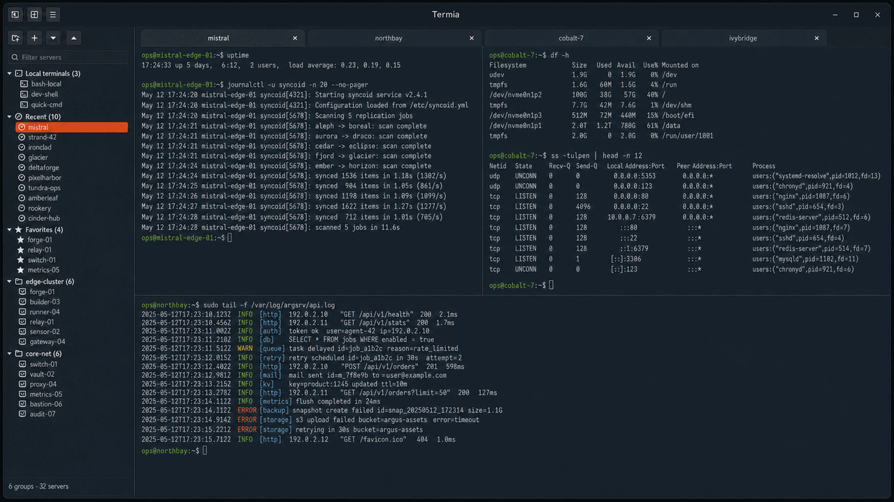

# Termia

Termia is a GTK 4 terminal workspace and SSH connection manager for Linux.
It brings local and remote sessions, saved workspaces, and file transfers
together in embedded VTE terminals.



[Español](docs/README.es.md) · [Català](docs/README.ca.md) · [Roadmap](ROADMAP.md)

## Features

- Local and SSH terminals with tabs, split panes, and detachable windows.
  Use `Ctrl+Shift+Arrow` to move between Termia panes; `Ctrl+Arrow` remains
  available to terminal applications such as tmux.
- Connections organized in nested groups, favorites, and recent connections.
  The connections sidebar starts hidden; use its header button to show it.
- Native private SSH key file picker when creating or editing a connection.
- Optional saved passwords for local terminal profiles. Enable the saved-password
  shortcut in preferences and press `Ctrl+P` (default) when `sudo` requests it;
  the active pane receives its own saved password, with optional Enter.
  The shortcut does not detect password prompts. Storage follows Security
  preferences; see [storage compatibility](docs/STORAGE_MIGRATIONS.md) before upgrading.
- Saved workspaces and optional restoration of the previous session.
- Per-pane status bars show the connection name and a colored session-state
  indicator; process and error details are available in the tooltip.
- Automatic copying when terminal selection finishes, enabled by default
  and configurable in General preferences. A success notification reports the character
  count, including spaces and line breaks, once the clipboard accepts the text.
  Click elsewhere in the terminal to clear the highlight without losing the copy.
- Confirmation before pasting terminal text containing line breaks, enabled
  by default in General preferences. Review the preview and choose Paste;
  Cancel or Escape sends nothing. Middle-button pastes are also protected;
  with protection enabled, Termia handles that button as paste even in
  terminal applications that normally handle mouse events.
- SCP uploads and a native SFTP file explorer with transfers and cancellation.
- Reusable command snippets with categories, scope, variables, and shortcuts;
  commands are previewed before sending them.
- Personal and server-linked notes with autosave, categories, and import/export.
  Open **Tools → Notes**; the notes sidebar opens hidden each time and can
  be shown with its header button.
  Right-click a note tab to rename, delete, clone, save, or close it; the editor
  retains its save status and modification time.
- Local connection storage with optional master-password encryption.
- Termia configuration import/export and connection import from Ásbrú YAML.
- Connection history and optional Statistics and SFTP add-ons.
- Configurable appearance, keybindings, and English, Spanish, and Catalan UI.
  Keyboard Shortcuts opens independently so terminals remain usable; changes
  apply on Save, and its buttons show full combinations.

**Retron** is available under **General → Theme**: solid dark
surfaces, subtle colored 1px borders, 10px corners and soft active-pane/tab lighting.
System/Light/Dark retain their previous interface styling. Each app theme saves
its own terminal text/background colors; Retron starts with Solarized text
on the sidebar's dark background (`#182231`).
Use Terminal preferences to change those colors for the selected theme at any
time. Notes editor colors remain independent. Retron adds terminal content padding and a subdued
main header without a halo.
With Retron active, use **Tools → Retron appearance editor** in the titlebar grid or
**General → Retron appearance editor** to open the same visual editor.
**Text fields → Focused component** controls entry and numeric-field borders and glows.
Customizing the focus border replaces the fixed cyan outline; keep a visible
border or glow for keyboard navigation. Notes uses its separate component.
Set a common style or customize a component and state;
check a property's box to override its inherited value. Borders, solid/gradient
backgrounds and up to three glows update live. Apply is temporary; Save persists
the profile. Use **Save as…** to keep a named configuration and continue editing.
The Configuration selector offers saved profiles, the current unnamed appearance
and Original Retron. Save updates the selected named profile; switching with
unsaved edits offers Save, Discard changes or Cancel. Rename and confirmed Delete
update the saved collection immediately; deleting a profile keeps the current
appearance. Up to 32 profiles can be stored, with unique names of 1–64 characters.
Cancel, Escape and closing the editor undo appearance changes since opening or
the last Save/Save as; they do not undo saved names or deletions. Restore defaults
is reversible until saved. Original Retron is always available.
The editor remains readable and native alerts retain their separate appearance.
Standard themes are unaffected. Terminal backgrounds are solid, with no blur or
ANSI-palette changes; an explicit Retron background temporarily overrides the
separate Terminal/Notes preference while Retron is active. See
[profile storage](docs/STORAGE_MIGRATIONS.md#retron-appearance-profile).

Retron also styles secondary window frames and shared Notes, snippets, SFTP, preferences
and update-log containers. Notes editor colors remain independent; native desktop portal
dialogs may retain the system theme.

The titlebar **Tools** grid also opens **Termia diagnostics**, an independent
window shared by the windows of the same application process. It separates CPU,
resident memory, threads and file descriptors of Termia and its local children,
and lists sessions, VTE terminals and SSH clients. Monitoring runs only while
open, approximately every five seconds. History is off while its section is
collapsed (the default); expanding it starts a new capture of up to 60 readings
in memory. Collapsing it stops recording and updating that panel. It never
contacts or measures remote servers. CPU uses 100% per core; summed resident
memory can count shared pages multiple times. SSH clients do not prove remote
authentication/connectivity. Possible orphan detection covers retained process
identities and children observed while monitoring, not all historical processes.
Unavailable values show a dash. No commands, environment variables or credentials
are collected and the tool does not terminate processes.

## Release status

**[0.6.2-beta](https://github.com/buuuki/termia/releases/tag/v0.6.2-beta)** is a
prerelease with Retron and named appearance configurations, the Tools launcher,
local diagnostics, terminal protections and interaction fixes.
See [CHANGELOG.md](CHANGELOG.md) for changes since 0.6.1-beta.

Before first running 0.6.2-beta, close Termia and back up your profile.
Connections upgrade to schema 4, which older versions cannot read. To downgrade,
restore the pre-upgrade backup and retain a separate copy of newer data.
See [storage compatibility](docs/STORAGE_MIGRATIONS.md#schema-inventory).

## Install on Ubuntu 24.04 or newer

Debian package:
[termia_0.6.2.beta-1_all.deb](https://github.com/buuuki/termia/releases/download/v0.6.2-beta/termia_0.6.2.beta-1_all.deb).

```bash
sudo apt install ./termia_0.6.2.beta-1_all.deb
```

APT installs the required dependencies, desktop launcher, and icon.
Launch **Termia** from the applications menu or run `termia`.

### Run from source

```bash
git clone https://github.com/buuuki/termia.git
cd termia
./scripts/termia-setup.sh install
python3 run_termia.py
```

The setup script checks runtime dependencies and installs a user-local launcher.
It supports Debian/Ubuntu/Linux Mint, Fedora, and Arch package managers.
Restart Termia only after setup succeeds; rerun setup if you move the checkout.
Use `./scripts/termia-setup.sh uninstall` to remove its launcher while keeping data.

### Runtime requirements

Python 3.10+, GTK 4, GtkSourceView 5, and the GTK 4 VTE namespace `Vte 3.91`.
Validation uses Ubuntu 24.04 and 26.04 laboratories. Ubuntu 22.04 and earlier
do not provide the required GTK 4 VTE runtime.

## Updates

**Beta.3 and beta.4 require a manual first upgrade.**
Back up your profile, close Termia, and install the new .deb over the old one.
There is no need to uninstall first.

For a clean source checkout, after the release tag is published:

```bash
git status --short
git fetch https://github.com/buuuki/termia.git tag v0.6.2-beta
git merge --ff-only v0.6.2-beta
./scripts/termia-setup.sh install
```

Stop if the first command lists local changes or the merge cannot fast-forward.
Complete setup before restarting; see
[storage compatibility](docs/STORAGE_MIGRATIONS.md) before downgrading.

From 0.6.1-beta, **About → Check for updates** detects newer beta/RC maintenance
within the same MAJOR.MINOR series, including later stable releases.
Stable installations are offered stable releases only.

The updater verifies downloads and reviews dependencies before installation.
Supported Git and Debian installations can use native administrator authorization
for required packages. Automatic Git updates require a clean release checkout on
main or its release tag; development branches and local changes need manual updates.
Unsupported cases retain the official release link. Let an installation finish,
then restart Termia; it does not update Debian-only rebuilds of the same app version.

## Help and isolated testing

Open **Help** from the main menu for workflows and your configured shortcuts.
The optional Statistics and SFTP add-ons are managed from **Add-ons**; changes
take effect after restarting and disabling them preserves their saved data.

To try a checkout using an empty profile, or a separate copy of your current data:

```bash
./scripts/run_test_instance.sh --fresh
./scripts/run_test_instance.sh --copy-current-config review
```

The first command creates a fresh profile; the second copies your current data.
Neither changes your usual profile. Read
[CONTRIBUTING.md](CONTRIBUTING.md) for development checks and diagnostics.

## Data and security

Configuration and notes are stored under `~/.config/termia/`; history and
statistics are under `~/.local/state/termia/`. Back them up before upgrading.
Saved credentials and exports may contain readable passwords unless encrypted.
Obfuscation is not encryption, and a lost master password cannot be recovered.

SSH startup commands run whenever their saved connection starts; treat them as
executable configuration. Termia does not keep a history of terminal commands,
output, or keystrokes. See [SECURITY.md](SECURITY.md) for storage, exports,
and update security.

The SFTP backend supports saved endpoints, SSH-agent/default keys, or passwords;
OpenSSH aliases, ProxyJump, hardware-key providers, and interactive MFA are not
supported. Existing destinations are not overwritten, and partial files or
directories may remain after a cancelled or failed transfer. Verify unknown
host fingerprints before accepting them; changed host keys are refused.

## Build a Debian package

From the repository root on Ubuntu 24.04+ or a compatible Debian system:

```bash
sudo apt build-dep .
dpkg-buildpackage -us -uc -b
```

The package is created in the parent directory as
`termia_0.6.2~beta-1_all.deb`. It is separate from the official release asset.

## Documentation

- [Contributing and validation](CONTRIBUTING.md)
- [Docker laboratories](tools/docker-lab/README.md)
- [Versioning](docs/VERSIONING.md) and [storage migrations](docs/STORAGE_MIGRATIONS.md)
- [Architecture](docs/architecture/overview.md)

## License

[GNU GPL v3.0 or later](LICENSE). Runtime dependencies are provided separately
by the operating system; see [third-party notices](THIRD_PARTY_NOTICES.md).
