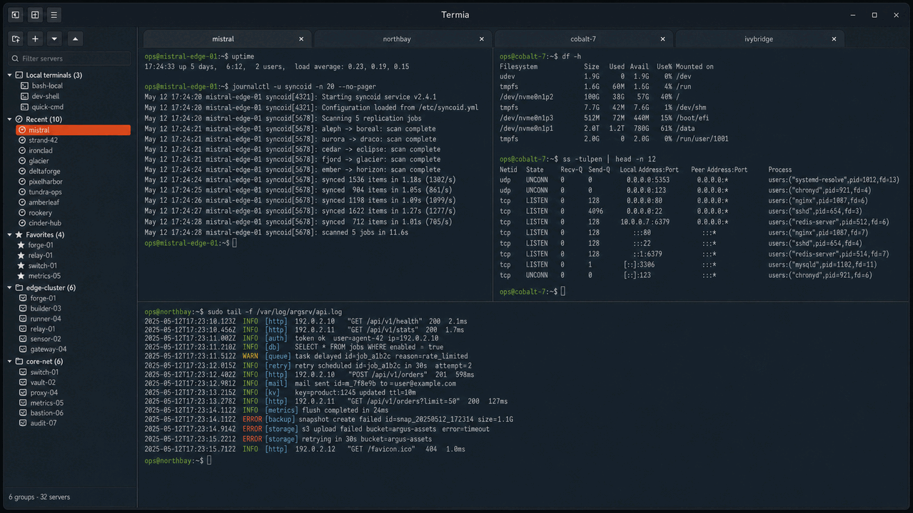

# Termia

Termia is a GTK 4 terminal workspace and SSH connection manager for Linux
desktops. It brings local and remote sessions, saved workspaces, and file
transfers together in embedded VTE terminals.



Spanish documentation: [docs/README.es.md](docs/README.es.md)
Catalan documentation: [docs/README.ca.md](docs/README.ca.md)
Roadmap: [ROADMAP.md](ROADMAP.md)

## Features

- Run SSH connections and local terminals in embedded GTK 4 VTE terminals.
- Use standard GTK context menus for terminals, saved connections, groups,
  local-terminal profiles, workspaces and notes, with keyboard navigation.
- Work with multiple tabs, detachable windows, and terminal split panes that
  can connect independently to different SSH servers or local terminals.
- Reach terminal tabs that do not fit using the automatically hiding horizontal
  scrollbar or the down-arrow tab list, refreshed when opened.
  Browse the connections tree with keyboard navigation and expandable
  groups; drag regular server rows between groups or into Ungrouped.
- The active terminal tab uses a background highlight without a blue underline;
  hovering an inactive tab produces a softer highlight.
- Sidebar selection highlights the icon and name with slightly rounded corners.
  In a detached terminal, Reattach to main window is directly below the status
  bar command in the terminal context menu.
- Save split layouts per SSH server or local terminal profile to reopen a workspace ready to use.
- Save named workspaces containing multiple tabs and independent SSH or local split panes, then reopen them from the sidebar.
- Restore the previous tabs and split layout on startup after confirmation; only saved connection references are stored, never terminal output, running processes, PIDs, passwords, or private paths.
- Enable `Restore the previous session when Termia starts` from `General` to opt into this behavior; it is disabled by default.
- Upload local files to remote servers with SCP from the terminal or server context menu.
- Browse remote files through a native SFTP explorer with navigation, transfers,
  progress, cancellation, and confirmed file operations.
- Enable or disable the bundled Statistics and SFTP add-ons from **Add-ons**
  in the main menu. Changes take effect after restarting Termia; disabling an
  add-on hides its actions but keeps its saved data.
- Check for official releases and install verified updates from `About`.
- Save reusable command snippets by category and scope them to all terminals, a
  server group, or one server; preview variable-expanded commands before
  explicitly sending them to a selected terminal. Manage them through a
  three-column view in an independent window with category counts, snippet
  lists, a read-only command preview, and global search. Terminals remain
  usable while the manager is open.
  Fixed-size category tiles use as many columns as fit and wrap when space is
  limited. Use **Back to snippets** to return from category management.
  Create, rename, duplicate, and delete categories independently; deleting a
  category moves its snippets to Uncategorized.
  Assign an optional keyboard shortcut beside Availability in the snippet
  editor or in the Snippets section of keyboard preferences. Both edit the
  same assignment; conflicts are rejected and shortcuts require Ctrl, Alt, or
  Super. With a terminal focused, the shortcut opens variables/preview for
  that pane when its scope matches; confirm before sending. Copies have no
  shortcut. Assignments are local keyboard settings, separate from connection
  exports; older versions may discard them when saving keyboard settings.
- Keep connection data locally with plain, obfuscated, or optional encrypted storage protected by a master password.
- Organize connections with nested groups, favorites, and a duplicate-free Recent section; find them quickly with `Ctrl+F`. Drag a saved server onto a group, subgroup, or Ungrouped to move it.
- Store host, user, port, password, private-key settings, and an optional startup command for each SSH connection.
- Import and export Termia configuration, including basic connections, nested groups, and available credentials from Asbru YAML.
  Importing an encrypted Termia file asks for its password; cancellation or an
  incorrect password leaves current data unchanged. The current profile keeps
  its own storage protection and password.
- Review connection history and optional local usage statistics, including durations and most-used servers.
- Keep personal notes or associate notes with servers; organize them with
  categories, edit them alongside terminal sessions, and import/export them
  separately from connection configuration.
- Customize terminal colors, fonts, local prompts, keybindings, confirmations, session status bars, language, and safe multi-instance behavior.

## What's new in 0.6.0-beta.4

Beta.4 is a prerelease. See the
[release review](https://github.com/buuuki/termia/issues/386) for validation and limitations.

- Keep personal and server-linked Notes in an independent window, with autosave,
  scoped/nested categories, plain-text appearance controls, native line numbers,
  and separate protected import/export.
- Change the master password for encrypted connections and Notes while preserving
  existing data. Legacy Notes receive a protected backup before schema upgrades.
- Manage snippets in an independent window, assign scoped keyboard shortcuts,
  and configure an optional command to run when an SSH connection starts.
- Reconnect an SSH or failed local pane while preserving sibling splits.
- Prompt for encrypted connection-import passwords and preserve the current
  profile protection; bound configuration size and encryption work.
- Enable or disable the bundled Statistics/SFTP tools without deleting their data.
- Use the approved scrolling terminal tab strip, native menus and connection/Notes
  trees, with improved keyboard focus, private dragging and session-title restore.
- Improve terminal/transfer shutdown, release retired terminal and SFTP widgets,
  and detect missing dependencies correctly when upgrading from source.
- Reproduce visual, SSH/SFTP/SCP, memory and lifecycle checks in the published
  Docker laboratory; observe real sudo/polkit upgrade trials in its optional VM.

Beta.4 adds GtkSourceView 5. Back up the profile before upgrading and consult
[storage compatibility](docs/STORAGE_MIGRATIONS.md) before downgrading.

## Help and terminal menu shortcuts

Open **Help** from the main menu for guidance grouped by workflow, including
notes, snippets, workspaces, security and updates. Its shortcut list reflects
your current keyboard preferences, including disabled assignments.
Terminal context menus show configured shortcuts for Copy, Paste and
**Tab → New tab**. Pasting from the menu returns focus to the clicked terminal
or split pane, so subsequent input stays in that terminal.

## SFTP explorer

Use **Browse files (SFTP)** in saved-server and SSH-pane context menus to open
an independent file window. Install dependencies using
`scripts/termia-setup.sh install`. Browse, upload files/folders, download into a
local folder, create directories, rename, and delete files or empty directories.
File-list sizes use B, kB, MB or GB according to their size.
Click once to select a file or directory for download. Double-click a directory
or press Enter while its row is focused to open it.
Existing destination paths and symbolic links are refused. Cancellation closes
SFTP; use **Reconnect SFTP** to continue. **Disconnect** closes the independent
SFTP window and connection, including during a transfer. Cancel, Reconnect SFTP,
and Disconnect appear on the right. Partial remote files and newly created
directories may remain after cancellation or failure. The SFTP window can move
behind the terminal window; its prompts are scoped to SFTP. Progress shows the
current file in MB, recent speed in MB/s and completed-file count. The tooltip
shows accumulated MB for the operation without repeating them in the bar.
Speed uses a recent three-second window across files. Folder totals are
unknown because transfers start without scanning the entire tree first.
Unexpected byte-count changes fail the transfer; this is not checksum
verification. Cancelling a rename or delete prompt keeps the connection usable.
Closing the owning tab or Termia requests SFTP cleanup without blocking GTK.
Reconnect stays unavailable until the previous worker and transport-close task
have exited. Cleanup still pending after 30 seconds is reported as unverified;
this deadline does not guarantee completion of a blocked OS/network call.

The Paramiko backend uses the saved endpoint and identity, SSH-agent/default
keys, or a password prompt. Verify unknown host fingerprints before accepting;
changed keys are refused. Entered passwords are held in memory only. OpenSSH
config aliases, ProxyJump, hardware-key providers, and interactive MFA are not
covered by this initial backend. SCP remains available. The SFTP feature was
introduced in beta.2 and remains available in beta.4.

## Download and install (Ubuntu 24.04+)

### Updates

The development updater shows whether Termia is installed from Git, a Debian
package (.deb), or an unsupported method. It downloads/verifies the target
before presenting new/changed requirements and locally missing dependencies.
The top status names missing dependencies, or lists the requirements when all
are available. Install missing dependencies with Termia and native administrator
authorization. There is no manual-dependency button. Missing requirements or
unavailable assisted installation keep the update pending; use the release
installation instructions in that case.
**The updated Termia will not start if mandatory dependencies are missing.**

When an older Termia process is still running after its clean Git checkout has
advanced to the selected release, the updater offers **Review dependencies**.
Install missing dependencies with Termia. Completion requires dependency
verification; afterwards close all Termia windows and open the application again.

**Installation details** shows phases and live package-manager/Git output in a
read-only, expandable log containing up to 65,536 characters. Select text and
press **Ctrl+C** to copy it;
starting another check clears it. URLs are hidden, but output can still contain
local paths or repository names: review it before sharing. Termia does not save
this log automatically. Administrator passwords belong only in Ubuntu's
authentication dialog, never in this log.

Assisted Git and Debian updates request native administrator authorization once
for the combined APT refresh and installation. A fixed helper from the running
Termia version performs both steps without collecting or caching passwords.
For Debian, it verifies and privately stages the package before refreshing APT.
A failed refresh or cancelled authorization stops installation; repository
access is required even when a local package is staged.

Assisted dependency planning currently supports Debian/Ubuntu with APT/dpkg.
For Git, required packages and runtime bindings are checked before the checkout
changes. For .deb, APT resolves requirements with the package transaction and
Termia verifies the installed version and requirements afterwards. No downloaded
setup script is run as root. Closing the update window before application
discards the staged update. System packages installed
before a later update failure are not automatically removed.

Published beta.4 and earlier updaters retain their previous behavior. For those
source upgrades, run `bash scripts/termia-setup.sh install` after updating and
before restarting. Existing beta.4 clients do not discover cross-PATCH beta
updates automatically; use the release instructions for that first transition.

Open **About → Check for updates** to check official GitHub releases. Beta/RC
installations using the development updater receive maintenance in the same
MAJOR.MINOR series (including stable deliveries); stable installations only offer newer stable releases. Checking is
manual and does not send configuration or SSH data.

**Download and review** stages the target before asking how to proceed.
Debian installations require a
compatible official package with a GitHub SHA-256 digest, APT, `pkexec` and a
desktop authentication agent. The package identity and version are checked before
the system asks for administrator authorization. Missing tools or verification
metadata leave the official release link available for manual installation.

Git updates require a clean checkout exactly at its current release tag, on
`main` or detached at that tag. The updater fetches the selected official tag and
only fast-forwards; development branches, local changes and divergent histories
require manual updating. With the published beta.4 updater, run
`scripts/termia-setup.sh install` afterwards to verify runtime dependencies
before restarting Termia.

For **beta.3 → beta.4 source upgrades**, run that setup command **before
restarting**: beta.4 adds GtkSourceView 5 (`gir1.2-gtksource-5` on Ubuntu).
The updater only changes the checkout; it does not install system packages.
After the fast-forward, the command runs the newly downloaded beta.4 setup,
including its corrected missing-dependency detection. On Ubuntu, setup invokes
`sudo apt-get update` and `sudo apt-get install` when dependencies are missing;
it may ask for your sudo password. If dependencies are already available, no
sudo is needed. The desktop launcher is installed in your user data directory.
Debian package upgrades resolve dependencies through APT instead.

See the [Docker upgrade compatibility report](docs/DOCKER_UPGRADE_VALIDATION.md)
for the Ubuntu 24.04/26.04 trials and their explicit limitations.

Checks and downloads can be cancelled. Once installation starts, allow it to
finish; closing Termia does not terminate the package-manager transaction.
Restart manually to use the new version. It does not update Debian-only rebuilds
of the same app version.

### Published package

Download [termia_0.6.0.beta.4-1_all.deb](https://github.com/buuuki/termia/releases/download/v0.6.0-beta.4/termia_0.6.0.beta.4-1_all.deb)
and install it with APT, which resolves the required dependencies:

```bash
sudo apt install ./termia_0.6.0.beta.4-1_all.deb
```

## Download from source

Clone the complete repository instead of downloading individual files:

```bash
git clone https://github.com/buuuki/termia.git
cd termia
```

## Install from source

Termia uses system GTK, VTE, and GtkSourceView 5 packages. Install missing
dependencies, verify the result, and add a user-local desktop launcher with:

```bash
chmod +x scripts/termia-setup.sh
./scripts/termia-setup.sh install
```

Before changing the system, the setup script lists the planned actions and waits
10 seconds so you can cancel. On Debian, Ubuntu, and Linux Mint, if `apt-get update`
fails because a configured repository is unavailable, it asks before using the
existing APT cache to install the required packages. If all runtime dependencies
are already available, it does not run the system package manager.

The dependency installer supports Debian, Ubuntu, Linux Mint, Fedora, and Arch Linux
package managers. It also tries to install JetBrains Mono for the default terminal
font; new installations use the Polaris palette and a white prompt color by
default, and Termia falls back to Ubuntu Mono or Monospace at runtime if JetBrains
Mono is unavailable.
Other Linux distributions require equivalent packages.

If the check reports a missing `Vte 3.91` namespace, the GTK 4 VTE introspection
package is missing. On Debian, Ubuntu, or Linux Mint the package is
`gir1.2-vte-3.91`.
The Notes editor also requires GtkSourceView 5 (`gir1.2-gtksource-5` on
Debian, Ubuntu, and Linux Mint). The setup script and Debian package install it.

## Run from a clone

```bash
python3 run_termia.py
```

To test a branch without closing your usual Termia window, launch an isolated
profile. It uses separate configuration, state, and writer lock:

```bash
./scripts/run_test_instance.sh --copy-current-config review
```

The option copies connections, notes, settings, connection history, statistics,
and the debug log into the test profile. Changes made there never modify your
usual Termia data.

Termia can migrate compatible configuration files from older versions. Once a
newer version saves a configuration, an older version may no longer be able to
open it. Back up your configuration before upgrading or switching versions, and
use isolated profiles when testing development branches.

For diagnostic information about tabs, splits, VTE process lifecycles, GTK
warnings, storage locks, encryption, and read-only startup, enable `Debug mode`
in General preferences. It can also be enabled for one run with:

```bash
python3 run_termia.py --debug
```

Debug output is written to `~/.local/state/termia/debug.log`. Fatal signals also
write the active Python stacks there when possible. It does not log passwords,
commands, terminal contents, connection endpoints, or private paths.

The launcher is installed at
`~/.local/share/applications/local.termia.desktop` and its icon under
`~/.local/share/icons/hicolor/scalable/apps/`.

Run the installer again after moving the cloned directory because the desktop
entry stores an absolute path to the source-checkout launcher.

Remove the launcher without deleting settings, connections, statistics, or system
packages:

```bash
./scripts/termia-setup.sh uninstall
```

## Build a Debian package

On Debian, Ubuntu 24.04 or newer, or a compatible derivative, install the build
dependencies and create the package from the repository root. Ubuntu 22.04 and
earlier do not provide the required GTK 4 VTE runtime:

```bash
sudo apt build-dep .
dpkg-buildpackage -us -uc -b
```

The resulting `termia_0.6.0~beta.4-1_all.deb` is created in the parent directory.
Locally built packages are separate from the official release assets linked above.

Install it with:

```bash
sudo apt install ../termia_0.6.0~beta.4-1_all.deb
```

The Debian package installs the `termia` command, desktop launcher, and icon;
APT installs its GTK, VTE, GtkSourceView, Python, SSH, and encryption dependencies.

## Usage notes

Connection group headers expand/collapse without becoming selected objects;
selection stays compact around the chosen object's icon and name. Context
menus support arrow-key navigation, Enter and Escape. The development
[Docker laboratory guide](tools/docker-lab/README.md) explains how to reproduce
the browser desktop and visual, memory and lifecycle tests on another PC.

The `Configuration` menu is split into `General`, `Terminal`, `Keybindings`, and `Security`:

- `General` controls the application theme, language, confirmations, startup behavior, password shortcut behavior, and the session status bar, which starts hidden by default.
- `Manage notes` opens a reusable modeless notes workspace. Notes are saved
  as plain text; characters such as `**`, `#`, and backticks are kept literally.
  The toolbar contains appearance controls only: font, size, text color,
  background, and a persistent line-number toggle. Line numbers are on by
  default. The editor starts with background `#001B33` and white text; the
  native GtkSourceView gutter uses `#0065BF` numbers on `#000D1A`. Appearance
  and toolbar visibility are persistent preferences shared by all notes,
  separate from note content. Notes uses an independent, modeless window with the same standard GTK
  controls as the main window. Opening it restores and presents it; either window
  can be brought to the front. Closing Notes hides its workspace for reuse;
  quitting Termia saves changes and closes both windows.
  Note tabs use GTK's native notebook for selection, drag reordering, and overflow.
  Its toggle beside the tabs hides or restores the compact toolbar while the
  smaller-text notes list stays in place. In read-only instances, appearance
  changes apply for that session.
  Notes are saved automatically, and the editor also offers an explicit **Save** button. Opening
  the window starts a new note draft, or resumes an existing draft for the same
  scope; read-only instances do not start drafts. Empty drafts are not stored;
  closing a draft with unsaved changes asks what to do. The editor's **Close tab**
  button follows the same save, discard, or keep-editing flow as the tab's X.
  The sidebar organizes notes as a tree: Personal contains personal categories;
  Servers contains servers with notes or saved categories, plus the server
  currently being worked on. Expand a server to browse its notes and categories.
  Saved empty categories remain visible. An unsaved “New note” draft appears
  under Uncategorized in its scope and is stored only after text is entered.
  Categories belong to their scope, so
  names can be reused across personal notes and different servers.
  Drag a category onto another to nest it, or onto its Personal/server header
  to return it to the root. Groups stay in the same scope; self and descendant
  drops are rejected. Names remain unique within each scope. Renaming preserves
  subgroups; deleting a category promotes its subgroups one level, while its
  own notes move to Uncategorized. Duplicating copies only that category's
  notes, alongside the original. Above search, **Expand all note groups** and
  **Collapse all note groups** control the entire tree without changing notes
  or open editors. Search temporarily reveals matching notes and their ancestors;
  clearing it restores the chosen expansion state.
  Uncategorized appears when that scope has uncategorized notes or an active
  draft. Rows
  are compact and show further details, including a linked note's saved
  category, in the compact right-click Properties dialog. A single click selects
  a note; a double click opens it in an editor tab. The selected tab has a
  theme-derived background highlight and retains GTK's blue underline. The
  writing area has a distinct, theme-aware background and border. Notes context menus and the Properties
  window use the same theme-aware surface as Termia's main menu. The title bar's left-side controls hide
  the list and open the Import/Export menu.
  The header keeps the new-note button beside the list toggle, even when the
  list is hidden. Above search, a button creates a category. Right-click a
  category to rename, duplicate it with its notes, or delete it. The main-menu
  manager opens with the full tree visible
  and Personal as the active creation scope; it offers import/export. Opening
  notes from a server's sidebar expands that server and
  hides import/export. Tabs use a scope icon; hovering over a server-note
  tab identifies its server. New note titles are numbered per scope (New note,
  New note 2, and so on).
  Notes can be categorized or kept as personal notes. Deleting a server keeps
  its notes as personal notes. Import replaces existing notes only after
  offering to back them up. Before export, Termia explains that choosing no
  password creates a readable plain-text file, while choosing a password
  encrypts the export and requires that password for import. Right-click a
  note in the list to edit, rename, clone, view properties, or delete it;
  cloning saves a copy with a new identity and the same content and associations.
- `Terminal` combines embedded VTE appearance and local prompt settings with one live preview. Appearance changes apply to open terminals; prompt changes apply only to new or duplicated local Bash terminals and never inject commands into running local shells or SSH sessions. New installations start with JetBrains Mono and the Polaris palette.
- Edit a saved SSH server to set `Run command on start`. Termia runs it after SSH authentication and leaves the session open with an interactive shell when it finishes. The command runs each time that server profile starts a session, including duplicated or restored sessions.
- `Keybindings` shows the active shortcuts and lets you record shortcut combinations for common actions such as server filtering, sidebar visibility, opening a local terminal, focus navigation, copy, paste, tab switching, font zoom, and sending the saved password. `Ctrl+F` focuses the server filter, `Ctrl+Shift+B` toggles the server list, `F10` toggles the main menu, `Ctrl+Shift+T` opens a local terminal, and `Ctrl+F6`/`Ctrl+Shift+F6` cycle through the main interface regions. Other unmodified function keys pass through to terminal applications.
- `Ctrl+Left`, `Ctrl+Right`, `Ctrl+Up`, and `Ctrl+Down` move focus between
  split panes by visual direction. These shortcuts can be reassigned or
  disabled if terminal applications need to receive those combinations.
- `Security` controls connection storage mode. For encrypted profiles, it also
  lets you change the master password; Termia verifies the current password and
  re-encrypts connections and notes with the new one.
- Use the terminal-shaped button in the sidebar to create a new local terminal profile; it appears in the sidebar list like a connection and opens an embedded terminal when activated.
- When another Termia instance is already running with the write lock, a new window opens in read-only mode, shows a header badge, disables write-capable actions, and still allows browsing, connecting, and exporting configuration.
- Right-click a terminal or a server to upload files to `/tmp/.termia/` on the target host.
- The main menu includes connection history, data file locations, and import/export actions.

Each terminal pane can show its own status bar with the connection name, state,
PID, elapsed time, a compact hide button, and disconnect action. Enable or
disable status bars from `General`; right-click inside a pane and choose `Show
session status bar` or `Hide session status bar` to toggle its own bar. The
directional `Split` actions duplicate the selected pane; choose `Open connection
in split…` to select a direction and a different saved SSH server or local
terminal. A tab supports up to 16 panes. Exiting or disconnecting one pane
leaves its siblings running, and the tab only closes on `exit` once its final
terminal has exited. A pane awaiting reconnection automatically reveals its
status bar with a `Close` action, while Enter remains available to retry.
Termia allows up to 40 open tabs in total, including tabs in detached windows.
Workspaces and server groups that do not fit within the remaining capacity are
rejected before any of their terminal processes start.
Use the save button in the sidebar to store the current tabs and split layout
as a named workspace. Workspaces appear in the sidebar with a grid icon; open,
update, rename, duplicate, or delete them from their context menu. A workspace
can contain up to 32 panes across all tabs and opens without an additional
confirmation. Saved workspaces also restore custom tab titles and the working
directory of each local terminal pane. SSH working directories are not
captured; unavailable local directories fall back to the terminal profile's
normal startup directory.

## Tested environment

Termia has been tested on Ubuntu 24.04.4 LTS with Linux kernel
6.8.0-117-generic, GNOME 46.0, and Wayland.

## Supported runtime baseline

Termia requires Python 3.10 or newer, GTK 4.0/GDK 4.0, GtkSourceView 5
(`GtkSource 5`), and the GTK 4 VTE introspection namespace `Vte 3.91`.
The current validation environment provides
GTK 4.14.5 and VTE 0.76.0. Compatibility guards for optional GTK methods such as
`set_handle_menubar_accel` and `set_show_separators` remain intentional so the
same source can run across distributions that expose different GTK API levels.

## Project layout

```text
run_termia.py                     Source-checkout launcher
src/termia/app.py             Application composition and window setup
src/termia/                Feature modules for storage, dialogs, tabs, terminal sessions, and UI helpers
src/termia/__main__.py        Python module entry point
src/termia/assets/            Desktop and About dialog artwork
src/termia/locale/            Compiled gettext catalogs bundled with Termia
po/                           Editable gettext translation catalogs
scripts/compile_translations.py
scripts/termia-setup.sh
docs/README.es.md             Spanish documentation
docs/README.ca.md             Catalan documentation
docs/VERSIONING.md            Application and Debian package version policy
SECURITY.md                    Credential storage warning
THIRD_PARTY_NOTICES.md         Runtime dependency licenses
LICENSE                       GPL-3.0-or-later license
```

The GTK implementation is split into focused modules for application composition,
storage, import, dialogs, preferences, sidebar, tabs, terminal sessions, and UI
helpers without changing the launch command.

## User data and security

Termia stores connection data, settings, and statistics outside the repository:

```text
~/.config/termia/connections.json   # groups, servers, and saved snippets where available
~/.config/termia/notes.json        # notes and categories
~/.config/termia/settings.json      # app and terminal settings
~/.config/termia/instance.lock      # single writer lock for multi-instance mode
~/.local/state/termia/connections-history.jsonl
~/.local/state/termia/statistics.json
~/.local/state/termia/last-session.json  # only when session restoration is enabled
```

Saved passwords and per-server startup commands are stored in `connections.json`; the file can be kept as plain text, obfuscated, or encrypted with a master password from Security preferences. A startup command runs automatically whenever its SSH profile starts a session. Treat it as executable configuration, do not put secrets in the command, and protect exported connection files, which can contain both passwords and startup commands. When encryption is enabled, Termia asks for the master password on startup and cannot recover the connection data if that password is lost. Change the master password from Security preferences; Termia verifies the current password and re-encrypts connections and notes. `notes.json` is a separate file, uses the same local protection mode, and is deliberately not included in connection imports or exports. Notes have their own import/export actions. Notes exports without a password are unencrypted JSON; a password selected during export encrypts the file and is required to import it. This export password is separate from the master password protecting local Termia data. Replacing existing notes creates a backup first. Imported Ásbrú passwords are stored the same way when the source YAML exposes them in a `pass` field. Exported connection files can also contain passwords. Aggregate usage counters are stored separately in `statistics.json`. When several Termia processes are open at the same time, only the instance holding `instance.lock` writes connections, settings, notes, or statistics; later instances stay read-only to avoid corrupting these files.
Connection history is stored separately in `connections-history.jsonl`; the
sidebar derives its small, deduplicated Recent section from successful SSH
connections in that history.

Termia does not record commands typed or executed in terminal panes as an
execution history, terminal output, clipboard contents, command counters, or
keystroke counters. Snippets and per-server startup commands are user-authored
configuration saved in `connections.json`, not a history of executed commands.
Statistics are
disabled by default and can be enabled from **Add-ons**. When enabled,
they track only aggregate connections, per-server usage, and session durations;
they are flushed at most every 30 seconds, when sessions end, and when Termia
closes. See [SECURITY.md](SECURITY.md).

Python may create `__pycache__/` directories next to executed modules. They only
contain generated bytecode, are excluded by `.gitignore`, and must not be
committed or distributed.

## License

Termia is licensed under the [GNU General Public License v3.0 or later](LICENSE).

Runtime dependencies are installed separately by the operating system and are
not vendored in this repository. See [THIRD_PARTY_NOTICES.md](THIRD_PARTY_NOTICES.md).

## Development checks

After editing `po/es.po` or `po/ca.po`, compile the gettext catalogs before
running Termia:

```bash
scripts/compile_translations.py
```

Use `scripts/compile_translations.py --check` to verify that `MESSAGES`, the
POT template, both PO catalogs, and the compiled MO files are synchronized.

```bash
python3 scripts/run_sandbox_tests.py
python3 -m py_compile run_termia.py scripts/compile_translations.py scripts/run_sandbox_tests.py src/termia/*.py tests/*.py
bash -n scripts/termia-setup.sh
```

The test runner uses a private GTK display and D-Bus session for restricted
Codex sandboxes; see [Regression Checks](docs/REGRESSION_CHECKS.md#automated-checks)
for prerequisites and focused runs. On an unrestricted system, the direct
`PYTHONPATH=src python3 -m unittest discover -s tests` command also works.
The same unit tests, translation checks, and Python syntax checks run
automatically in GitHub Actions for every pull request and every push to `main`.

Review the files included in the first commit:

```bash
git status --short --ignored
git ls-files --others --exclude-standard
```
