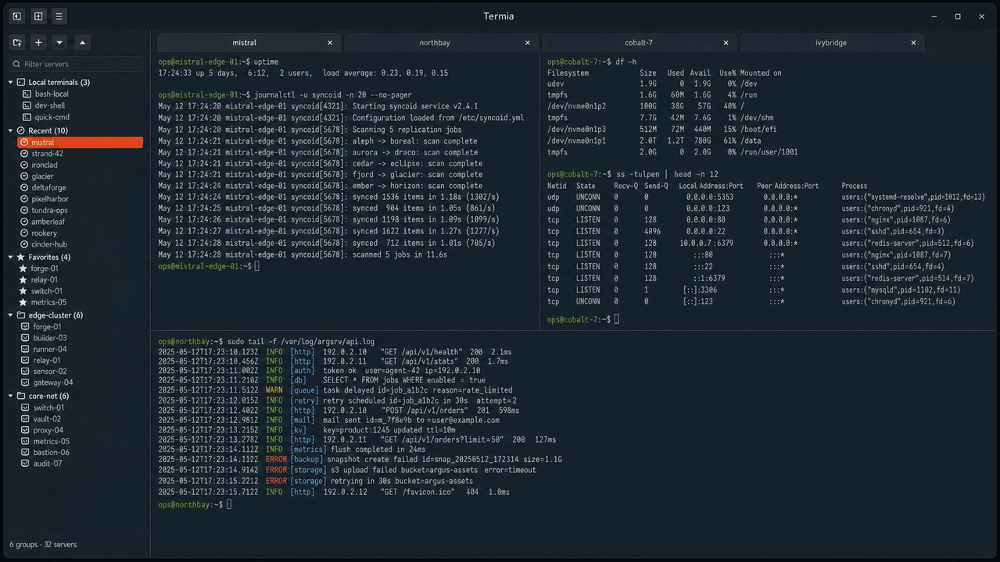

# Termia

Termia és un gestor de connexions SSH i espais de treball de terminal per a Linux.
Reuneix sessions locals i remotes, espais de treball desats i transferències de
fitxers en terminals VTE integrats amb GTK 4.

**Aquest README descriu `0.6.4-beta`, una versió preliminar de manteniment.**
Inclou correccions de temes, barres laterals, barres d'estat i divisions del
terminal, Notes, previsualització d'enganxament, snippets i llançadors. Han passat
les proves de l'aplicació i les comprovacions d'instal·lació, actualització
i Wayland del paquet als laboratoris existents d'Ubuntu 24/26.
Els resultats, les limitacions i l'estat de publicació són a
[#532](https://github.com/buuuki/termia/issues/532). Els enllaços de descàrrega i
les ordres d'actualització mitjançant l'etiqueta estaran disponibles quan es
publiqui aquesta versió.



[English](../README.md) · [Castellà](README.es.md) · [Full de ruta](../ROADMAP.md)

## Funcionalitats

- Terminals locals i SSH amb pestanyes, panells dividits i finestres separables.
  Fes servir `Ctrl+Shift+fletxes` per moure't entre panells de Termia;
  `Ctrl+fletxes` queda disponible per a aplicacions del terminal com tmux.
- Connexions organitzades en grups imbricats, preferits i connexions recents.
  La barra lateral de connexions comença oculta; mostra-la amb el botó de capçalera.
  Les barres laterals de connexions i Notes recorden l’amplada entre sessions.
  Els separadors nadius es poden arrossegar fins als extrems per amagar
  un panell, sense mínims fixos ni màxims percentuals.
- Selector nadiu de claus SSH privades en crear o editar una connexió.
- Contrasenya opcional als perfils de terminal local. Activa la drecera d'enviament
  a les preferències i prem `Ctrl+P` (per defecte) quan `sudo` la demani;
  el panell actiu rep la seva contrasenya desada, amb Retorn opcional.
  La drecera no detecta peticions de contrasenya. La protecció depèn de
  Seguretat; consulta la [compatibilitat](STORAGE_MIGRATIONS.md) abans d'actualitzar.
- Espais de treball desats i restauració opcional de la sessió anterior.
- Cada barra d'estat mostra el nom de la connexió i un indicador d'estat amb
  color; en passar-hi el ratolí es veuen els detalls del procés o error.
  Els terminals locals mostren Iniciant, En execució o Finalitzat i fan servir
  Finalitzar terminal / Obrir terminal. Després de finalitzar manualment l'únic
  terminal d'una pestanya que continua oberta, Obrir terminal (local) o
  Connectar (SSH) inicia una sessió nova en aquell panell. Desconnectar un split
  continua eliminant-lo; es conserva l'opció de tancar la pestanya automàticament.
  La icona × finalitza/desconnecta la sessió, ↑ amaga la barra i la fletxa
  circular obre/reconnecta una sessió finalitzada. Cada acció té una ajuda.
  Quan està amagada, ↓ a la cantonada superior dreta del terminal mostra la
  barra d'aquell panell. Preferències de terminal reuneix la visibilitat inicial
  de la barra i l'opció del botó ↓, activada per defecte.
- Còpia automàtica en acabar de seleccionar text del terminal,
  activada per defecte i configurable a Preferències generals. L'avís confirma la còpia i
  indica els caràcters, inclosos espais i salts de línia, quan el porta-retalls
  accepta el text. Un clic en una altra zona treu el ressaltat sense perdre la còpia.
- Confirmació abans d'enganxar text amb salts de línia al terminal, activada
  per defecte a Preferències generals. Revisa o edita el text i prem Enganxar,
  que rep el focus inicial. Retorn a l’editor insereix una línia; Tab porta
  als botons. Cancel·lar o Escapament no envien res. També protegeix el botó
  central: mentre està activada, Termia el tracta com una enganxada fins i
  tot en aplicacions del terminal que normalment gestionen el ratolí.
- Pujades SCP i explorador SFTP nadiu amb transferències i cancel·lació.
- Snippets reutilitzables amb categories, àmbit, variables i dreceres;
  les ordres es previsualitzen abans d'enviar-les.
- Notes personals o associades a servidors, amb desament automàtic,
  categories i importació/exportació. Fes clic dret en una pestanya per
  reanomenar, eliminar, clonar, desar o tancar-la; l’editor conserva l’estat
  de desament i la data de modificació. Obre **Eines → Notes**; la barra
  lateral s’oculta en cada obertura i pots mostrar-la amb el botó de capçalera.
  El cursor d’inserció segueix el color del text de l’editor. Canvia els colors
  amb els selectors de la barra; arrossegar un color sobre la nota no l’insereix.
- Dades de connexió locals amb xifratge opcional mitjançant contrasenya mestra.
- Importació/exportació de Termia i importació de connexions des d'Ásbrú YAML.
- Historial de connexions i complements opcionals d'Estadístiques i SFTP.
- Aparença i dreceres configurables; interfície en català, castellà i anglès.
  Dreceres s’obre en una finestra independent per continuar fent servir els terminals;
  els canvis s’apliquen en desar i els botons mostren les combinacions completes.

**Retron** està disponible a **General → Tema**:
superfícies fosques opaques, vores de color subtils d'1px, cantonades de 10px
i il·luminació suau als panells i les pestanyes actius. Clar i Fosc fan servir
les variants del tema integrat de GTK; Sistema segueix l'escriptori. No canvien
els ajustos de l'escriptori. Cada tema desa els seus colors de text i fons del terminal;
Retron comença amb text Solarized i el fons fosc del panell lateral (`#182231`).
Pots canviar-los quan vulguis des de les
preferències del terminal: es desen per al tema seleccionat. Els colors de
l'editor de Notes continuen sent independents.
Retron afegeix espai interior al terminal i una barra de títol tènue sense
halo lluminós.
Amb Retron actiu, obre l’editor d’aparença des d’**Eines**, la quadrícula de la barra de títol,
o des de **General**. Tots dos accessos obren la mateixa finestra.
**Camps de text → Component amb focus** permet ajustar les vores i resplendors de les
entrades de text i numèriques. Personalitzar la vora amb focus substitueix el
contorn cian fix; conserva una vora o resplendor visible per navegar amb teclat.
Notes té el seu propi component.
Pots canviar l’estil comú o un component i estat; marca la casella
d’una propietat per personalitzar-la. Les vores, els fons llisos o amb degradat
i fins a tres resplendors es previsualitzen al moment. Aplica és temporal;
Desa conserva el perfil. **Desa com a…** crea una configuració amb nom i permet
continuar editant. El selector Configuració ofereix els perfils desats,
l’aparença actual sense nom i Retron original. Desa actualitza el perfil
seleccionat; en canviar amb ajustos pendents es pot desar, descartar o cancel·lar.
Canviar el nom i confirmar Suprimeix actualitzen la col·lecció al moment;
suprimir conserva l’aparença actual. S’admeten fins a 32 perfils amb noms únics
d’1–64 caràcters. Cancel·la, Escape i tancar desfan els ajustos d’aparença des de
l’obertura o l’últim Desa/Desa com a; no desfan noms desats ni supressions.
Restaura els valors es pot cancel·lar fins que es desa i Retron original sempre
està disponible. L’editor conserva la llegibilitat i les alertes el seu aspecte
independent; els altres temes no canvien. El fons VTE és llis, sense difuminat
ni canvis a la paleta ANSI. Un fons Retron explícit preval temporalment sobre
les preferències independents de Terminal/Notes mentre Retron està actiu.
Consulta l’[emmagatzematge del perfil](STORAGE_MIGRATIONS.md#retron-appearance-profile).

Retron també aplica el seu estil als marcs de finestres secundàries i als contenidors
compartits de Notes, snippets, SFTP, preferències i registres de l’actualitzador. Els
colors de l’editor de Notes són independents; els diàlegs del portal de l’escriptori
poden conservar el tema del sistema.

En aquesta branca de desenvolupament, Diagnòstic es distribueix com a plugin
separat. Els usuaris actuals l'han d'instal·lar manualment per continuar
utilitzant-lo després d'actualitzar. Termia no el descarrega ni l'instal·la
automàticament. Aquest canvi no modifica les versions ja publicades.

Obtén l'arxiu de Diagnòstic compatible i el seu fitxer `.sha256` del
distribuïdor de plugins de confiança. Encara no hi ha cap descàrrega pública
d'aquest paquet de desenvolupament. Tanca Termia i, des del directori que
conté tots dos fitxers, executa:

```bash
sha256sum -c termia-plugin-diagnostics-0.1.0.dev0.tar.gz.sha256 &&
plugin_root="${XDG_DATA_HOME:-$HOME/.local/share}/termia/plugins" &&
test ! -e "$plugin_root/diagnostics" &&
mkdir -p "$plugin_root" &&
tar -xzf termia-plugin-diagnostics-0.1.0.dev0.tar.gz -C "$plugin_root"
```

Aquestes ordres són per a una primera instal·lació i s'aturen si Diagnòstic
ja existeix. Si has definit `TERMIA_PLUGINS_DIR`, utilitza aquell directori.
El paquet requereix l'API de plugins 2; la seva versió és independent de Termia.
Els plugins s'executen amb els permisos de Termia, sense aïllament. La suma
de comprovació verifica la integritat, no l'autenticitat del distribuïdor.

Reinicia Termia. Diagnòstic s'activa per defecte en la primera instal·lació;
les preferències desades tenen prioritat. Gestiona'n l'activació des del diàleg
d'eines opcionals; Desa aplica els canvis. Eliminar el plugin no esborra la
preferència desada.

Amb el plugin instal·lat i activat, **Eines** obre
**Diagnòstic de Termia**, una finestra independent compartida
per les finestres del mateix procés. Separa CPU, memòria resident, fils i descriptors
de Termia i els seus fills locals, i mostra sessions, terminals VTE i clients SSH.
Només supervisa mentre és oberta, aproximadament cada cinc segons. L’historial
està desactivat mentre la seva secció està plegada, com en obrir la finestra.
Desplegar-lo inicia una captura nova de fins a 60 lectures en memòria; plegar-lo
atura el registre i l’actualització del panell. No contacta ni mesura servidors remots. Un nucli equival
al 100% de CPU; sumar memòria resident pot comptar pàgines compartides diverses
vegades. Els clients SSH no garanteixen autenticació ni connexió remota.
Els possibles orfes es detecten amb identitats conservades o fills observats durant
la supervisió; no cobreix tots els processos històrics. Les mesures no disponibles
apareixen com un guió. No recull ordres, variables d’entorn ni credencials,
i no acaba processos.

Estadístiques també es distribueix per separat a [termia-plugins](https://github.com/buuuki/termia-plugins).
Per instal·lar-lo, fes servir les ordres anteriors substituint `diagnostics` per
`statistics` tant al nom de l’arxiu com a la comprovació del directori de
destinació. Reinicia Termia després d’instal·lar o actualitzar el plugin. En la
primera instal·lació es respecta la preferència anterior del perfil. En un perfil
nou, Estadístiques comença desactivat. Desactivar-lo o treure’l conserva la
preferència desada i l’historial de `statistics.json`.

## Estat de la versió

**[0.6.4-beta](https://github.com/buuuki/termia/releases/tag/v0.6.4-beta)** continua
en beta i inclou correccions de temes, barres laterals, terminals, Notes
i llançadors. Consulta [CHANGELOG.md](../CHANGELOG.md)
per veure els canvis des de 0.6.3-beta.
El tancament inesperat de GTK/Wayland (#499) i la investigació general sobre
el moviment de Notes (#489) continuen oberts.

Abans d’actualitzar, tanca Termia i fes una còpia de seguretat del perfil.
Abans de tornar de `0.6.4-beta` a `0.6.3-beta`, restaura el `settings.json`
previ: la versió anterior rebutja la nova preferència del botó per mostrar
la barra d'estat i pot restablir les preferències del terminal als valors
predeterminats. Les versions anteriors ignoren les amplades de les barres laterals.
Les versions anteriors a 0.6.2-beta no poden llegir l’esquema 4 de connexions.
Per tornar enrere, restaura la còpia prèvia i conserva
les dades més recents per separat. Consulta la
[compatibilitat de l’emmagatzematge](STORAGE_MIGRATIONS.md#schema-inventory).

## Instal·lar a Ubuntu 24.04 o posterior

Paquet Debian:
[termia_0.6.4.beta-1_all.deb](https://github.com/buuuki/termia/releases/download/v0.6.4-beta/termia_0.6.4.beta-1_all.deb).

```bash
sudo apt install ./termia_0.6.4.beta-1_all.deb
```

APT instal·la les dependències necessàries, el llançador i la icona.
Obre **Termia** des del menú d'aplicacions o executa `termia`.

### Executar des del codi font

```bash
git clone https://github.com/buuuki/termia.git
cd termia
./scripts/termia-setup.sh install
python3 run_termia.py
```

L'script comprova les dependències i instal·la un llançador per a l'usuari.
Admet els gestors de paquets de Debian/Ubuntu/Linux Mint, Fedora i Arch.
Reinicia Termia només quan acabi correctament; repeteix-lo si mous el checkout.
Usa `./scripts/termia-setup.sh uninstall` per treure el llançador conservant les dades.

Fes clic amb el botó dret a la icona de Termia del dock o de la graella
d'aplicacions del GNOME i tria **Nova instància**. Si comparteix el mateix
perfil, la segona instància serà de només lectura. En instal·lacions des
del codi, repeteix `./scripts/termia-setup.sh install` per actualitzar el llançador.

A Preferències generals, **Clar** i **Fosc** fan servir l'aparença integrada
de GTK, independentment del tema de l'escriptori. **Sistema** segueix
l'escriptori i **Retron** aplica els seus estils propis. No canvia la configuració
de l'escriptori.

### Requisits

Python 3.10+, GTK 4, GtkSourceView 5 i l'espai VTE per a GTK 4 `Vte 3.91`.
Les comprovacions es fan en laboratoris Ubuntu 24.04 i 26.04.
Ubuntu 22.04 i anteriors no proporcionen el VTE per a GTK 4 necessari.

## Actualitzacions

**`0.6.0-beta.3` i `0.6.0-beta.4` requereixen una primera actualització manual a una versió PATCH posterior.**
Fes una còpia del perfil, tanca Termia i instal·la el nou .deb sobre l'anterior.
No cal desinstal·lar primer.

Per a un checkout net, un cop publicada l'etiqueta:

```bash
git status --short
git fetch https://github.com/buuuki/termia.git tag v0.6.4-beta
git merge --ff-only v0.6.4-beta
./scripts/termia-setup.sh install
```

Atura't si la primera ordre mostra canvis locals o el merge no pot avançar
mitjançant fast-forward. Completa el setup abans de reiniciar i consulta la
[compatibilitat de dades](STORAGE_MIGRATIONS.md) abans de tornar a una versió anterior.

Des de 0.6.1-beta, **Quant a → Cerca actualitzacions** detecta versions de
manteniment beta/RC posteriors de la mateixa sèrie MAJOR.MINOR, incloses
versions estables posteriors. Les instal·lacions estables només reben estables.

L'actualitzador verifica les descàrregues i revisa les dependències abans d'instal·lar.
Les instal·lacions compatibles des de Git o Debian poden usar l'autorització
administrativa nadiua per als paquets necessaris. Git requereix un checkout net
d'una release a main o a la seva etiqueta; les branques de desenvolupament i canvis
locals s'actualitzen manualment. En casos no compatibles es conserva l'enllaç oficial.
Deixa acabar la instal·lació i reinicia Termia; no actualitza revisions exclusivament
Debian de la mateixa versió de l'aplicació.

## Ajuda i proves aïllades

Obre **Ajuda** des del menú principal per consultar els fluxos d'ús i les dreceres.
Gestiona Estadístiques i SFTP des de **Complements**. Els canvis d’activació
d’Estadístiques s’apliquen en prémer **Desa**. SFTP està integrat i canviar-ne l’activació requereix reiniciar.

Per provar un checkout amb un perfil buit o una còpia separada d'algunes dades:

```bash
./scripts/run_test_instance.sh --fresh
./scripts/run_test_instance.sh --fresh --copy-current-config review
```

Totes dues ordres creen un perfil aïllat nou i mantenen intacte l'habitual.
La segona copia connexions, notes, preferències, historial de connexions,
estadístiques i registre de depuració des de les ubicacions XDG habituals.
No copia els perfils d'aparença Retron ni l'última sessió desada, i no utilitza
`TERMIA_CONFIG_DIR` ni `TERMIA_STATE_DIR` per localitzar el perfil d'origen.
Les còpies poden contenir credencials i dades privades. Aïllar el perfil no
impedeix connectar-se als servidors desats; fes servir dades fictícies per a les proves.
El llançador mostra les rutes de configuració i estat del perfil. Els fitxers
romanen després de tancar Termia; elimina el perfil de prova quan no el necessitis.
Consulta
[CONTRIBUTING.md](../CONTRIBUTING.md) per a les comprovacions i el diagnòstic.

## Dades i seguretat

La configuració i les notes es desen a `~/.config/termia/`; l'historial i les
estadístiques, a `~/.local/state/termia/`. Fes una còpia abans d'actualitzar.
Les credencials i exportacions poden contenir contrasenyes llegibles si no es
xifren. L'ofuscació no és xifratge i una contrasenya mestra perduda no es recupera.

Les ordres d'inici SSH s'executen cada vegada que s'inicia la connexió;
tracta-les com a configuració executable. Termia no registra les ordres del
terminal, la sortida ni les pulsacions. Consulta [SECURITY.md](../SECURITY.md)
per a l'emmagatzematge, les exportacions i les actualitzacions.

L'explorador SFTP admet les dades desades, claus de l'agent SSH o per defecte
i contrasenyes; no admet àlies d'OpenSSH, ProxyJump, proveïdors de claus físiques
ni MFA interactiva. No sobreescriu destinacions existents i pot deixar fitxers o
directoris parcials en cancel·lar o fallar una transferència. Verifica les empremtes
d'amfitrions desconeguts abans d'acceptar-les; els canvis de clau es rebutgen.

## Crear un paquet Debian

Des de l'arrel del repositori a Ubuntu 24.04+ o un sistema Debian compatible:

```bash
sudo apt build-dep .
dpkg-buildpackage -us -uc -b
```

El paquet es crea al directori pare com a `termia_0.6.4~beta-1_all.deb`.
Una compilació local és independent del fitxer oficial de la release
i no té necessàriament la mateixa suma de comprovació.

## Documentació

- [Contribució i validació](../CONTRIBUTING.md)
- [Laboratoris Docker](../tools/docker-lab/README.ca.md)
- [Versionat](VERSIONING.md) i [migracions de dades](STORAGE_MIGRATIONS.md)
- [Arquitectura](architecture/overview.md)

## Llicència

[GNU GPL v3.0 o posterior](../LICENSE). El sistema operatiu proporciona les
dependències per separat; consulta els [avisos de tercers](../THIRD_PARTY_NOTICES.md).
