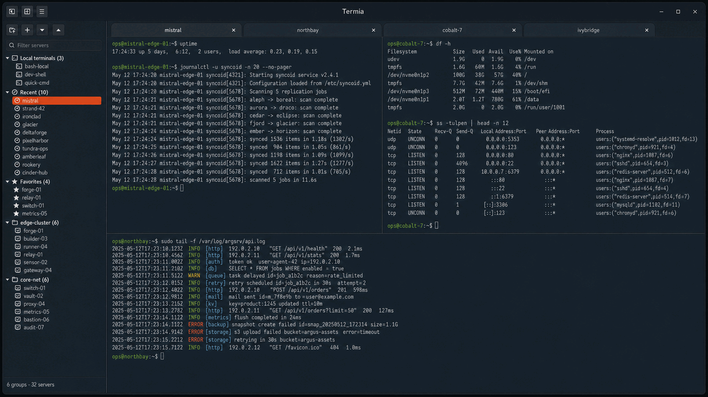

# Termia

Termia és un gestor de connexions SSH i espais de treball de terminal per a Linux.
Reuneix sessions locals i remotes, espais de treball desats i transferències de
fitxers en terminals VTE integrats amb GTK 4.



[English](../README.md) · [Castellà](README.es.md) · [Full de ruta](../ROADMAP.md)

## Funcionalitats

- Terminals locals i SSH amb pestanyes, panells dividits i finestres separables.
  Fes servir `Ctrl+Shift+fletxes` per moure't entre panells de Termia;
  `Ctrl+fletxes` queda disponible per a aplicacions del terminal com tmux.
- Connexions organitzades en grups imbricats, preferits i connexions recents.
- Selector nadiu de claus SSH privades en crear o editar una connexió.
- Contrasenya opcional als perfils de terminal local. Activa la drecera d'enviament
  a les preferències i prem `Ctrl+P` (per defecte) quan `sudo` la demani;
  el panell actiu rep la seva contrasenya desada, amb Retorn opcional.
  La drecera no detecta peticions de contrasenya. La protecció depèn de
  Seguretat; consulta la [compatibilitat](STORAGE_MIGRATIONS.md) abans d'actualitzar.
- Espais de treball desats i restauració opcional de la sessió anterior.
- Cada barra d'estat mostra el nom de la connexió i un indicador d'estat amb
  color; en passar-hi el ratolí es veuen els detalls del procés o error.
- Còpia automàtica en acabar de seleccionar text del terminal,
  activada per defecte i configurable a Preferències generals. L'avís confirma la còpia i
  indica els caràcters, inclosos espais i salts de línia, quan el porta-retalls
  accepta el text. Un clic en una altra zona treu el ressaltat sense perdre la còpia.
- Confirmació abans d'enganxar text amb salts de línia al terminal, activada
  per defecte a Preferències generals. Revisa la previsualització i prem
  Enganxar; Cancel·lar o Escapament no envien res. També protegeix el botó
  central: mentre està activada, Termia el tracta com una enganxada fins i
  tot en aplicacions del terminal que normalment gestionen el ratolí.
- Pujades SCP i explorador SFTP nadiu amb transferències i cancel·lació.
- Snippets reutilitzables amb categories, àmbit, variables i dreceres;
  les ordres es previsualitzen abans d'enviar-les.
- Notes personals o associades a servidors, amb desament automàtic,
  categories i importació/exportació. Fes clic dret en una pestanya per
  reanomenar, eliminar, clonar, desar o tancar-la; l’editor conserva l’estat
  de desament i la data de modificació.
- Dades de connexió locals amb xifratge opcional mitjançant contrasenya mestra.
- Importació/exportació de Termia i importació de connexions des d'Ásbrú YAML.
- Historial de connexions i complements opcionals d'Estadístiques i SFTP.
- Aparença i dreceres configurables; interfície en català, castellà i anglès.
  Dreceres s’obre en una finestra independent per continuar fent servir els terminals;
  els canvis s’apliquen en desar i els botons mostren les combinacions completes.

Aquesta branca d'investigació afegeix **Retron** a **General → Tema**:
superfícies fosques opaques, vores de color subtils d'1px, cantonades de 10px
i il·luminació suau als panells i les pestanyes actius. Sistema/Clar/Fosc conserven
l'aspecte anterior. Cada tema desa els seus colors de text i fons del terminal;
Retron comença amb text Solarized i el fons fosc del panell lateral (`#182231`).
Pots canviar-los quan vulguis des de les
preferències del terminal: es desen per al tema seleccionat. Els colors de
l'editor de Notes continuen sent independents.
Retron afegeix espai interior al terminal i una barra de títol tènue sense
halo lluminós. És una
opció local d'investigació, no una versió publicada.
Amb Retron actiu, obre l’editor d’aparença amb el botó de la barra de títol
o des de **General**. Tots dos accessos obren la mateixa finestra.
Pots canviar l’estil comú o un component i estat; marca la casella
d’una propietat per personalitzar-la. Les vores, els fons llisos o amb degradat
i fins a tres resplendors es previsualitzen al moment. Aplica és temporal;
Desa conserva el perfil. **Desa com a…** crea una configuració amb nom i permet
continuar editant. El selector Configuració ofereix els perfils desats,
l’aparença actual sense nom i Retron original. Desa actualitza el perfil
seleccionat; en canviar amb ajustos pendents es pot desar, descartar o cancel·lar.
Canviar el nom i confirmar Suprimeix actualitzen la col·lecció al moment;
suprimir conserva l’aparença actual. S’admeten fins a 32 perfils amb noms únics
d’1–64 caràcters. Cancel·la, Escape i tancar desfan els ajustos d’aparença des de
l’obertura o l’últim Desa/Desa com a; no desfan noms desats ni supressions.
Restaura els valors es pot cancel·lar fins que es desa i Retron original sempre
està disponible. L’editor conserva la llegibilitat i les alertes el seu aspecte
independent; els altres temes no canvien. El fons VTE és llis, sense difuminat
ni canvis a la paleta ANSI. Un fons Retron explícit preval temporalment sobre
les preferències independents de Terminal/Notes mentre Retron està actiu.
Consulta l’[emmagatzematge del perfil](STORAGE_MIGRATIONS.md#retron-appearance-profile).

Retron també aplica el seu estil als marcs de finestres secundàries i als contenidors
compartits de Notes, snippets, SFTP, preferències i registres de l’actualitzador. Els
colors de l’editor de Notes són independents; els diàlegs del portal de l’escriptori
poden conservar el tema del sistema.

## Estat de la versió

**[0.6.1-beta](https://github.com/buuuki/termia/releases/tag/v0.6.1-beta)** és una
versió preliminar de manteniment. Consulta [CHANGELOG.md](../CHANGELOG.md)
per veure els canvis des de 0.6.0-beta.4.

## Instal·lar a Ubuntu 24.04 o posterior

Paquet Debian:
[termia_0.6.1.beta-1_all.deb](https://github.com/buuuki/termia/releases/download/v0.6.1-beta/termia_0.6.1.beta-1_all.deb).

```bash
sudo apt install ./termia_0.6.1.beta-1_all.deb
```

APT instal·la les dependències necessàries, el llançador i la icona.
Obre **Termia** des del menú d'aplicacions o executa `termia`.

### Executar des del codi font

```bash
git clone https://github.com/buuuki/termia.git
cd termia
./scripts/termia-setup.sh install
python3 run_termia.py
```

L'script comprova les dependències i instal·la un llançador per a l'usuari.
Admet els gestors de paquets de Debian/Ubuntu/Linux Mint, Fedora i Arch.
Reinicia Termia només quan acabi correctament; repeteix-lo si mous el checkout.
Usa `./scripts/termia-setup.sh uninstall` per treure el llançador conservant les dades.

### Requisits

Python 3.10+, GTK 4, GtkSourceView 5 i l'espai VTE per a GTK 4 `Vte 3.91`.
Les comprovacions es fan en laboratoris Ubuntu 24.04 i 26.04.
Ubuntu 22.04 i anteriors no proporcionen el VTE per a GTK 4 necessari.

## Actualitzacions

**Beta.3 i beta.4 requereixen una primera actualització manual a 0.6.1-beta.**
Fes una còpia del perfil, tanca Termia i instal·la el nou .deb sobre l'anterior.
No cal desinstal·lar primer.

Per a un checkout net, un cop publicada l'etiqueta:

```bash
git status --short
git fetch https://github.com/buuuki/termia.git tag v0.6.1-beta
git merge --ff-only v0.6.1-beta
./scripts/termia-setup.sh install
```

Atura't si la primera ordre mostra canvis locals o el merge no pot avançar
mitjançant fast-forward. Completa el setup abans de reiniciar i consulta la
[compatibilitat de dades](STORAGE_MIGRATIONS.md) abans de tornar a una versió anterior.

Des de 0.6.1-beta, **Quant a → Cerca actualitzacions** detecta versions de
manteniment beta/RC posteriors de la mateixa sèrie MAJOR.MINOR, incloses
versions estables posteriors. Les instal·lacions estables només reben estables.

L'actualitzador verifica les descàrregues i revisa les dependències abans d'instal·lar.
Les instal·lacions compatibles des de Git o Debian poden usar l'autorització
administrativa nadiua per als paquets necessaris. Git requereix un checkout net
d'una release a main o a la seva etiqueta; les branques de desenvolupament i canvis
locals s'actualitzen manualment. En casos no compatibles es conserva l'enllaç oficial.
Deixa acabar la instal·lació i reinicia Termia; no actualitza revisions exclusivament
Debian de la mateixa versió de l'aplicació.

## Ajuda i proves aïllades

Obre **Ajuda** des del menú principal per consultar els fluxos d'ús i les dreceres.
Els complements opcionals d'Estadístiques i SFTP es gestionen des de
**Complements**; els canvis requereixen reiniciar i desactivar-los conserva les dades.

Per provar un checkout amb un perfil buit o una còpia separada de les teves dades:

```bash
./scripts/run_test_instance.sh --fresh
./scripts/run_test_instance.sh --copy-current-config review
```

La primera ordre crea un perfil buit; la segona copia les dades actuals.
Cap de les dues modifica el perfil habitual. Consulta
[CONTRIBUTING.md](../CONTRIBUTING.md) per a les comprovacions i el diagnòstic.

## Dades i seguretat

La configuració i les notes es desen a `~/.config/termia/`; l'historial i les
estadístiques, a `~/.local/state/termia/`. Fes una còpia abans d'actualitzar.
Les credencials i exportacions poden contenir contrasenyes llegibles si no es
xifren. L'ofuscació no és xifratge i una contrasenya mestra perduda no es recupera.

Les ordres d'inici SSH s'executen cada vegada que s'inicia la connexió;
tracta-les com a configuració executable. Termia no registra les ordres del
terminal, la sortida ni les pulsacions. Consulta [SECURITY.md](../SECURITY.md)
per a l'emmagatzematge, les exportacions i les actualitzacions.

L'explorador SFTP admet les dades desades, claus de l'agent SSH o per defecte
i contrasenyes; no admet àlies d'OpenSSH, ProxyJump, proveïdors de claus físiques
ni MFA interactiva. No sobreescriu destinacions existents i pot deixar fitxers o
directoris parcials en cancel·lar o fallar una transferència. Verifica les empremtes
d'amfitrions desconeguts abans d'acceptar-les; els canvis de clau es rebutgen.

## Crear un paquet Debian

Des de l'arrel del repositori a Ubuntu 24.04+ o un sistema Debian compatible:

```bash
sudo apt build-dep .
dpkg-buildpackage -us -uc -b
```

El paquet es crea al directori pare com a `termia_0.6.1~beta-1_all.deb`.
És independent del fitxer oficial de la release.

## Documentació

- [Contribució i validació](../CONTRIBUTING.md)
- [Laboratoris Docker](../tools/docker-lab/README.ca.md)
- [Versionat](VERSIONING.md) i [migracions de dades](STORAGE_MIGRATIONS.md)
- [Arquitectura](architecture/overview.md)

## Llicència

[GNU GPL v3.0 o posterior](../LICENSE). El sistema operatiu proporciona les
dependències per separat; consulta els [avisos de tercers](../THIRD_PARTY_NOTICES.md).
