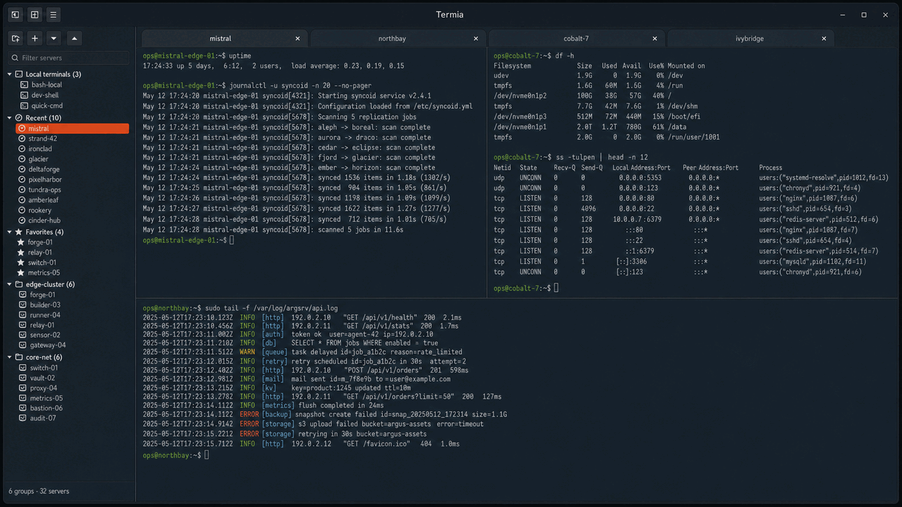

# Termia

Termia es un gestor de conexiones SSH y espacios de trabajo de terminal para Linux.
Reúne sesiones locales y remotas, espacios de trabajo guardados y transferencias
de archivos en terminales VTE integrados con GTK 4.



[English](../README.md) · [Català](README.ca.md) · [Hoja de ruta](../ROADMAP.md)

## Características

- Terminales locales y SSH con pestañas, paneles divididos y ventanas separables.
  Usa `Ctrl+Shift+flechas` para moverte entre paneles de Termia; `Ctrl+flechas`
  queda disponible para aplicaciones del terminal como tmux.
- Conexiones organizadas en grupos anidados, favoritos y conexiones recientes.
  El sidebar de conexiones empieza oculto; usa su botón de cabecera para mostrarlo.
  Los paneles laterales de conexiones y Notas recuerdan su ancho entre sesiones.
  Sus separadores nativos se pueden arrastrar hasta los bordes para ocultar
  un panel, sin mínimos fijos ni máximos porcentuales.
- Selector nativo de claves SSH privadas al crear o editar una conexión.
- Contraseña opcional en los perfiles de terminal local. Activa el atajo de envío
  en las preferencias y pulsa `Ctrl+P` (predeterminado) cuando `sudo` la solicite;
  el panel activo recibe su contraseña guardada, con Enter opcional.
  El atajo no detecta solicitudes de contraseña. La protección depende de
  Seguridad; consulta la [compatibilidad](STORAGE_MIGRATIONS.md) antes de actualizar.
- Espacios de trabajo guardados y restauración opcional de la sesión anterior.
- Cada barra de estado muestra el nombre de la conexión y un indicador de
  estado con color; al pasar el ratón se ven los detalles del proceso o error.
  Los terminales locales muestran Iniciando, En ejecución o Finalizado y usan
  Finalizar terminal / Abrir terminal. Tras finalizar manualmente el único
  terminal de una pestaña que permanece abierta, Abrir terminal (local) o
  Conectar (SSH) inicia una sesión nueva en ese panel. Desconectar un split
  sigue eliminándolo; se conserva la opción de cerrar la pestaña automáticamente.
- Copia automática al terminar de seleccionar texto del terminal,
  activada por defecto y configurable en Preferencias generales. El aviso confirma la copia
  e indica los caracteres, incluidos espacios y saltos de línea, cuando el
  portapapeles acepta el texto. Un clic en otra zona quita el resaltado sin perder la copia.
- Confirmación antes de pegar texto con saltos de línea en el terminal,
  activada por defecto en Preferencias generales. Revisa o edita el texto y
  pulsa Pegar, que recibe el foco inicial. Enter en el editor inserta una línea;
  Tab lleva a los botones. Cancelar o Escape no envían nada. También protege el botón
  central: mientras está activada, Termia lo trata como pegado incluso en
  aplicaciones del terminal que normalmente gestionan el ratón.
- Subidas SCP y explorador SFTP nativo con transferencias y cancelación.
- Snippets reutilizables con categorías, ámbito, variables y atajos;
  los comandos se previsualizan antes de enviarlos.
- Notas personales o asociadas a servidores, con guardado automático,
  categorías e importación/exportación. Haz clic derecho en una pestaña para
  renombrar, eliminar, clonar, guardar o cerrarla; el editor conserva el estado
  de guardado y la fecha de modificación. Abre **Herramientas → Notas**;
  su sidebar se oculta en cada apertura y puedes mostrarlo con su botón de cabecera.
- Datos de conexión locales con cifrado opcional mediante contraseña maestra.
- Importación/exportación de Termia e importación de conexiones desde Ásbrú YAML.
- Historial de conexiones y complementos opcionales de Estadísticas y SFTP.
- Apariencia y atajos configurables; interfaz en castellano, catalán e inglés.
  Atajos se abre en una ventana independiente para seguir usando los terminales;
  los cambios se aplican al guardar y sus botones muestran las combinaciones completas.

**Retron** está disponible en **General → Tema**: superficies
oscuras opacas, bordes coloreados sutiles de 1px, esquinas de 10px e iluminación
suave en paneles y pestañas activos. Sistema/Claro/Oscuro conservan su aspecto
anterior. Cada tema guarda sus propios colores de texto y fondo del terminal;
Retron empieza con texto Solarized y el fondo oscuro del sidebar (`#182231`).
Puedes cambiarlos cuando quieras desde las
preferencias del terminal: se guardan para el tema seleccionado. Los colores
del editor de Notas siguen siendo independientes.
Retron añade espacio interior al terminal y una barra de título tenue sin
halo luminoso.
Con Retron activo, abre el editor de apariencia desde **Herramientas**, la cuadrícula de la barra de
título, o desde **General**. Ambos accesos abren la misma ventana.
**Campos de texto → Componente con foco** permite ajustar los bordes y halos de entradas
de texto y numéricas. Personalizar el borde con foco sustituye el contorno cian
fijo; conserva un borde o halo visible para navegar con teclado. Notas tiene
su propio componente.
Puedes cambiar el estilo común o un componente y estado;
marca la casilla de una propiedad para personalizarla. Los bordes, fondos
lisos o con gradiente y hasta tres halos se previsualizan al momento.
Aplicar es temporal; Guardar conserva el perfil. **Guardar como…** crea una
configuración con nombre y permite seguir editando. El selector Configuración
ofrece los perfiles guardados, la apariencia actual sin nombre y Retron original.
Guardar actualiza el perfil seleccionado; al cambiar con ajustes pendientes se
puede guardar, descartar o cancelar. Renombrar y confirmar Eliminar actualizan
la colección al momento; eliminar conserva la apariencia actual. Se admiten
hasta 32 perfiles con nombres únicos de 1–64 caracteres.
Cancelar, Escape y cerrar deshacen los ajustes de apariencia desde la apertura
o el último Guardar/Guardar como; no deshacen nombres guardados ni eliminaciones.
Restaurar valores puede cancelarse hasta guardar y Retron original siempre está
disponible. El editor conserva su legibilidad
y las alertas su aspecto independiente; los demás temas no cambian.
El fondo VTE es liso, sin difuminado ni cambios en la paleta ANSI. Un fondo
Retron explícito prevalece temporalmente sobre las preferencias independientes
de Terminal/Notas mientras Retron está activo. Consulta el
[almacenamiento del perfil](STORAGE_MIGRATIONS.md#retron-appearance-profile).

Retron también aplica su estilo a los marcos de ventanas secundarias y los contenedores
compartidos de Notas, snippets, SFTP, preferencias y registros del actualizador. Los
colores del editor de Notas son independientes; los diálogos del portal del escritorio
pueden conservar el tema del sistema.

**Herramientas** también abre **Diagnóstico de Termia**, una ventana independiente
compartida por las ventanas del mismo proceso. Separa CPU, memoria residente,
hilos y descriptores de Termia y sus hijos locales, y muestra sesiones, terminales
VTE y clientes SSH. Solo supervisa mientras está abierta, aproximadamente cada cinco
segundos. El historial está desactivado mientras su sección está plegada, como
al abrir la ventana. Desplegarlo inicia una nueva captura de hasta 60 lecturas en
memoria; plegarlo detiene su registro y actualización. No contacta ni mide servidores remotos.
Un núcleo equivale al 100% de CPU; sumar memoria residente puede contar páginas
compartidas varias veces. Los clientes SSH no garantizan autenticación ni conexión
remota. Los posibles huérfanos se detectan mediante identidades conservadas o hijos
observados durante la supervisión; no cubre todos los procesos históricos.
Las medidas no disponibles aparecen como un guion. No recoge órdenes, variables
de entorno ni credenciales, y no termina procesos.

## Estado de la versión

**[0.6.3-beta](https://github.com/buuuki/termia/releases/tag/v0.6.3-beta)** es una
versión preliminar con correcciones de
reapertura de terminales, pegado multilínea editable y cambios de interacción
en Notas y las barras laterales. Consulta [CHANGELOG.md](../CHANGELOG.md)
para ver los cambios desde 0.6.2-beta.
El cierre inesperado de GTK/Wayland (#499) y la investigación general sobre
el movimiento de Notas (#489) siguen abiertos.

Antes de actualizar, cierra Termia y copia tu perfil como respaldo.
Las versiones anteriores a 0.6.2-beta no pueden leer el esquema 4 de conexiones.
Para volver atrás, restaura la copia previa y conserva aparte
los datos más recientes. Consulta la
[compatibilidad del almacenamiento](STORAGE_MIGRATIONS.md#schema-inventory).

## Instalar en Ubuntu 24.04 o posterior

Paquete Debian:
[termia_0.6.3.beta-1_all.deb](https://github.com/buuuki/termia/releases/download/v0.6.3-beta/termia_0.6.3.beta-1_all.deb).

```bash
sudo apt install ./termia_0.6.3.beta-1_all.deb
```

APT instala las dependencias necesarias, el lanzador y el icono.
Abre **Termia** desde el menú de aplicaciones o ejecuta `termia`.

### Ejecutar desde el código fuente

```bash
git clone https://github.com/buuuki/termia.git
cd termia
./scripts/termia-setup.sh install
python3 run_termia.py
```

El script comprueba las dependencias e instala un lanzador para el usuario.
Admite los gestores de paquetes de Debian/Ubuntu/Linux Mint, Fedora y Arch.
Reinicia Termia solo cuando termine correctamente; repítelo si mueves el checkout.
Usa `./scripts/termia-setup.sh uninstall` para quitar el lanzador conservando los datos.

Pulsa con el botón derecho en el icono de Termia del dock o de la cuadrícula
de aplicaciones de GNOME y elige **Nueva instancia**. Si comparte el mismo
perfil, la segunda instancia será de solo lectura. En instalaciones desde
el código, repite `./scripts/termia-setup.sh install` para actualizar el lanzador.

### Requisitos

Python 3.10+, GTK 4, GtkSourceView 5 y el namespace VTE para GTK 4 `Vte 3.91`.
Las comprobaciones se realizan en laboratorios Ubuntu 24.04 y 26.04.
Ubuntu 22.04 y anteriores no proporcionan el VTE para GTK 4 necesario.

## Actualizaciones

**Beta.3 y beta.4 requieren una primera actualización manual.**
Haz una copia del perfil, cierra Termia e instala el nuevo .deb sobre el anterior.
No hace falta desinstalar primero.

Para un checkout limpio, una vez publicada la etiqueta:

```bash
git status --short
git fetch https://github.com/buuuki/termia.git tag v0.6.3-beta
git merge --ff-only v0.6.3-beta
./scripts/termia-setup.sh install
```

Detente si el primer comando muestra cambios locales o el merge no puede avanzar
mediante fast-forward. Completa el setup antes de reiniciar y consulta la
[compatibilidad de datos](STORAGE_MIGRATIONS.md) antes de volver a una versión anterior.

Desde 0.6.1-beta, **Acerca de → Buscar actualizaciones** detecta versiones de
mantenimiento beta/RC posteriores de la misma serie MAJOR.MINOR, incluidas
versiones estables posteriores. Las instalaciones estables solo reciben estables.

El actualizador verifica las descargas y revisa las dependencias antes de instalar.
Las instalaciones compatibles desde Git o Debian pueden usar la autorización
administrativa nativa para los paquetes necesarios. Git requiere un checkout limpio
de una release en main o en su etiqueta; las ramas de desarrollo y cambios locales
se actualizan manualmente. En casos no compatibles se conserva el enlace oficial.
Deja terminar la instalación y reinicia Termia; no actualiza revisiones exclusivamente
Debian de la misma versión de la aplicación.

## Ayuda y pruebas aisladas

Abre **Ayuda** desde el menú principal para consultar los flujos de uso y tus atajos.
Los complementos opcionales de Estadísticas y SFTP se gestionan desde
**Complementos**; los cambios requieren reiniciar y desactivarlos conserva sus datos.

Para probar un checkout con un perfil vacío o una copia separada de tus datos:

```bash
./scripts/run_test_instance.sh --fresh
./scripts/run_test_instance.sh --copy-current-config review
```

El primer comando crea un perfil vacío; el segundo copia los datos actuales.
Ninguno modifica tu perfil habitual. Consulta
[CONTRIBUTING.md](../CONTRIBUTING.md) para las comprobaciones y el diagnóstico.

## Datos y seguridad

La configuración y las notas se guardan en `~/.config/termia/`; el historial y
las estadísticas, en `~/.local/state/termia/`. Haz una copia antes de actualizar.
Las credenciales y exportaciones pueden contener contraseñas legibles si no se
cifran. La ofuscación no es cifrado y una contraseña maestra perdida no se recupera.

Los comandos de inicio SSH se ejecutan cada vez que se inicia su conexión;
trátalos como configuración ejecutable. Termia no registra los comandos del
terminal, su salida ni las pulsaciones. Consulta [SECURITY.md](../SECURITY.md)
para el almacenamiento, las exportaciones y las actualizaciones.

El explorador SFTP admite los datos guardados, claves del agente SSH o por defecto
y contraseñas; no admite alias de OpenSSH, ProxyJump, proveedores de claves físicas
ni MFA interactivo. No sobrescribe destinos existentes y puede dejar archivos o
directorios parciales al cancelar o fallar una transferencia. Verifica las huellas
de hosts desconocidos antes de aceptarlas; los cambios de clave se rechazan.

## Crear un paquete Debian

Desde la raíz del repositorio en Ubuntu 24.04+ o un sistema Debian compatible:

```bash
sudo apt build-dep .
dpkg-buildpackage -us -uc -b
```

El paquete se crea en el directorio padre como `termia_0.6.3~beta-1_all.deb`.
Es independiente del archivo oficial de la release.

## Documentación

- [Contribución y validación](../CONTRIBUTING.md)
- [Laboratorios Docker](../tools/docker-lab/README.es.md)
- [Versionado](VERSIONING.md) y [migraciones de datos](STORAGE_MIGRATIONS.md)
- [Arquitectura](architecture/overview.md)

## Licencia

[GNU GPL v3.0 o posterior](../LICENSE). El sistema operativo proporciona las
dependencias por separado; consulta los [avisos de terceros](../THIRD_PARTY_NOTICES.md).
